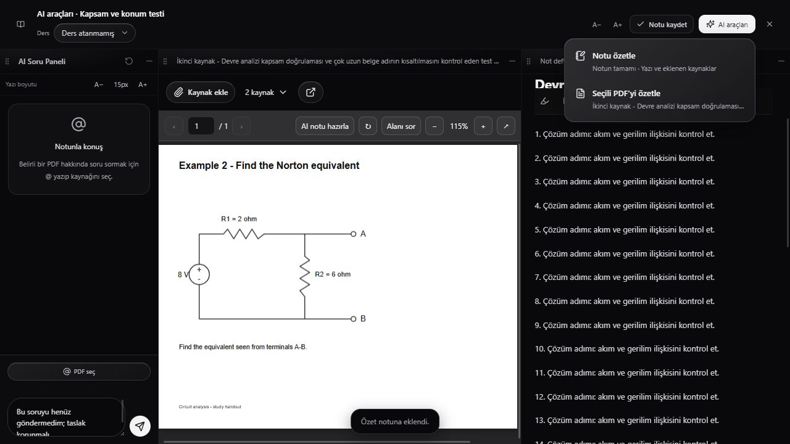
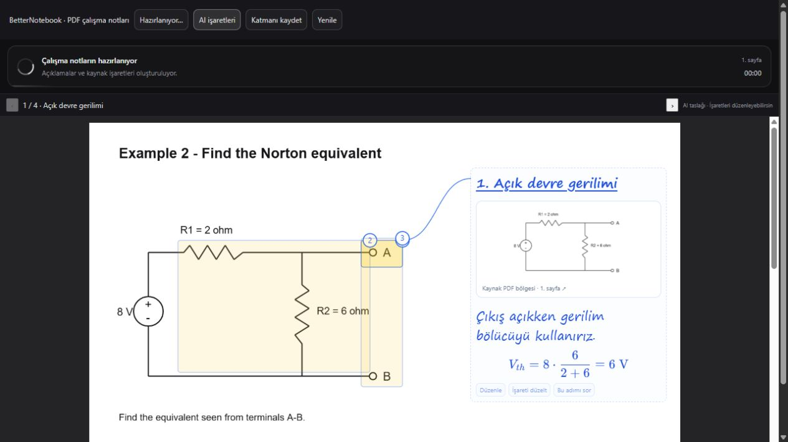
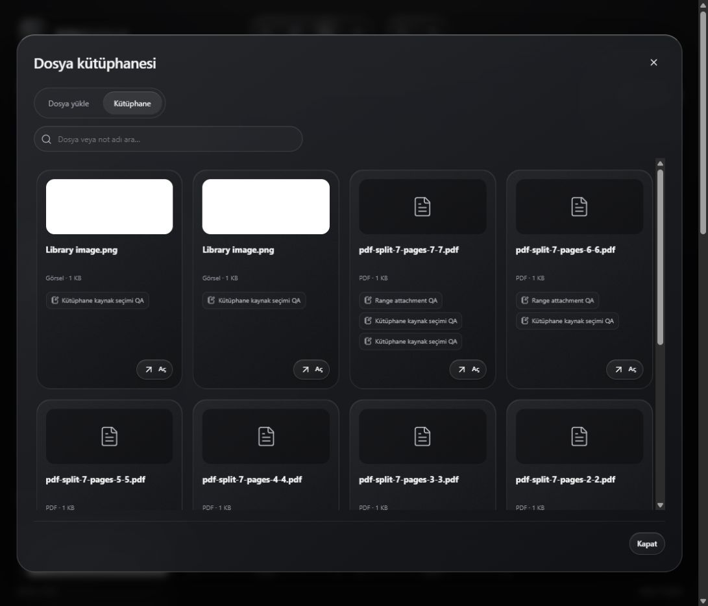

<p align="center">
  
</p>

<h1 align="center">BetterNotebook</h1>

<p align="center"><strong>Read PDFs, take notes, and ask AI in one workspace.</strong></p>

<p align="center">
  
  
  
  
</p>

<p align="center"><strong>English</strong> · <a href="README.tr.md">Türkçe</a></p>

<p align="center">
  <a href="https://betternotebook.mecebi.com.tr/">Website</a> ·
  <a href="#screenshots">Screenshots</a> ·
  <a href="#quick-start">Quick start</a> ·
  <a href="#server-installation">Server installation</a>
</p>

BetterNotebook is a self-hosted study workspace. Select a circuit, formula, or diagram in a PDF, follow a step-by-step explanation alongside the source, and add useful answers to your own notes.

## Features

| Feature | What you can do |
| --- | --- |
| Three-panel workspace | Read a PDF, edit a note, and chat with AI side by side. Resize and reorder the panels. |
| PDF tools | Split a document by page range, ask about a selected area, and review page annotations. |
| Rich notes | Start with a blank note, highlight text, write equations, and insert AI answers. |
| Library and study sessions | Reuse files across notes and track focus sessions by course. |
| Trash | Restore notes, files, and courses within 30 days, or empty the trash manually. |

## Screenshots



| PDF explanations | File library |
| --- | --- |
|  |  |

Screenshots use sample study material.

## Quick start

**Requirements**: PHP 8.1 or later, MySQL or MariaDB, and the `pdo_mysql`, `mbstring`, `curl`, `openssl`, and `fileinfo` PHP extensions.

1. Clone the repository. Create an empty database and a database user with permissions on it. Copy `app/config/database.example.php` to `app/config/database.custom.php` and fill in your database settings.
2. From the repository root, run the command twice. Each run generates a distinct 64-character value.

   ```sh
   php app/scripts/database.php secret
   php app/scripts/database.php secret
   ```

   Replace the placeholders in `app/config/database.custom.php` with the outputs in order:

   ```php
   define('BETTERNOTEBOOK_ENCRYPTION_KEY', 'FIRST_OUTPUT');
   define('BETTERNOTEBOOK_SETUP_TOKEN', 'SECOND_OUTPUT');
   ```

   The **second output** is the setup code you enter in the browser. The first output stays on the server and encrypts stored Gemini keys. Keep both values out of Git.

3. Start the local server from the repository root.

   ```sh
   php -S 127.0.0.1:8080 -t app dev/router.php
   ```

4. Open [the setup screen](http://127.0.0.1:8080/setup.php). Enter the setup token and create your first account. After setup, remove only `BETTERNOTEBOOK_SETUP_TOKEN` from the configuration and keep a secure backup of `BETTERNOTEBOOK_ENCRYPTION_KEY`.
5. Sign in. To use AI features, add your Gemini API key under **Settings**.

## Server installation

Use `app/` as the document root for a dedicated domain or subdomain. The app includes Apache rewrite rules and an [Nginx/PHP-FPM example](docs/nginx.conf.example). Create the database first, make `uploads/notes/` writable by PHP, and complete initial setup over HTTPS.

Run `php scripts/database.php upgrade` from the application directory when upgrading an existing installation. Schedule `php scripts/database.php purge-trash` hourly to remove expired items. The detailed server guide covers Apache, Nginx, cPanel, and migration. [Installation guide in Turkish](docs/installation.md)

## Repository layout

| Path | Purpose |
| --- | --- |
| `app/` | PHP application, runtime assets, and database schema |
| `dev/` | Local PHP development router |
| `editor-source/` | Rich-text editor source and dependency lockfile |
| `site/` | Static product website |
| `docs/` | Installation guides, branding, and screenshots |

## License

The project license will be selected before the first public release. Bundled third-party components include their [license notices](app/assets/vendor/).
