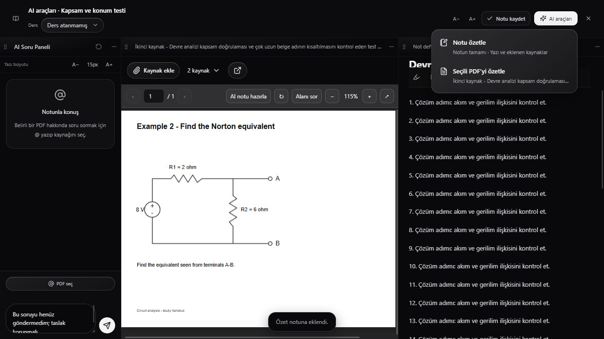
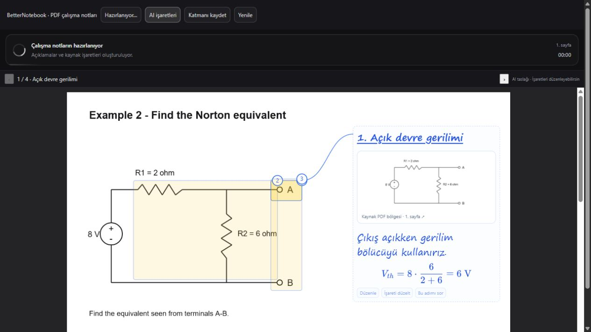
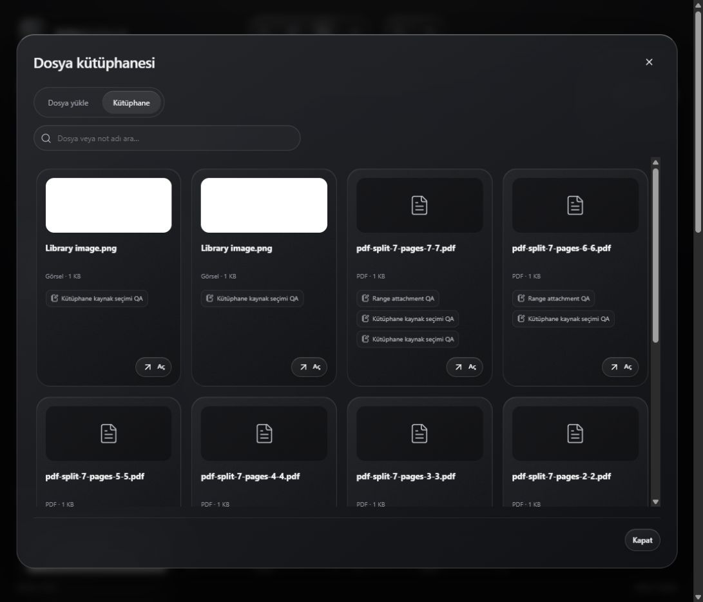

<p align="center">
  
</p>

<h1 align="center">BetterNotebook</h1>

<p align="center"><strong>PDF, notlar ve yapay zekâ tek çalışma alanında.</strong></p>

<p align="center">
  
  
  
  
</p>

<p align="center"><a href="README.md">English</a> · <strong>Türkçe</strong></p>

<p align="center">
  <a href="https://betternotebook.mecebi.com.tr/">Tanıtım sitesi</a> ·
  <a href="#ekran-görüntüleri">Ekran görüntüleri</a> ·
  <a href="#hızlı-kurulum">Kurulum</a> ·
  <a href="docs/installation.md">Sunucu kurulumu ve yükseltme</a> ·
  <a href="docs/cloudflare-pages.md">Cloudflare Pages kılavuzu</a>
</p>

BetterNotebook, PDF okurken kaynakla ilgili soru sormayı, yanıtları kendi notlarına eklemeyi ve öğrendiklerini düzenlemeyi kolaylaştırır. Bir devreyi veya formülü PDF üzerinde seçebilir, adım adım açıklamayı takip edebilir ve notuna dönebilirsin.

## Neler yapabilirsin?

- **Kaynağı, notu ve AI sohbetini birlikte aç.** Panellerin sırasını ve genişliğini değiştir.
- **PDF üzerinde çalış.** Belgeyi sayfa aralıklarına böl, seçili bir alanı AI'a sor ve kaynak üzerinde üretilen açıklamaları incele.
- **Kendi notunu oluştur.** Dosyasız başlayabilir, matematiksel ifadeler ve vurgular ekleyebilir, AI yanıtlarını notuna aktarabilirsin.
- **Dosyalarını ve derslerini düzenle.** Kaynakları farklı notlarda kullan, çalışma oturumlarını ders bazında takip et. Not, dosya ve dersleri çöp kutusundan 30 gün içinde geri yükle.

## Ekran görüntüleri

| Çalışma alanı | PDF üzerinde adım adım açıklama |
| --- | --- |
|  |  |

<details>
<summary>Dosya kütüphanesi</summary>



</details>

Görüntüler örnek çalışma verileriyle çekilmiştir.

## Hızlı kurulum

Gereksinimler: PHP 8.1 veya üstü, MariaDB veya MySQL, `pdo_mysql`, `mbstring`, `curl`, `openssl` ve `fileinfo`. Kurulumda kullanılacak boş bir veritabanı ve o veritabanına yetkili bir kullanıcı oluştur.

1. Depoyu yereline al ve `app/config/database.example.php` dosyasını aynı dizinde `database.custom.php` olarak kopyala. Veritabanı bilgilerini özel dosyaya yaz.
2. **Kurulum kodunu kendin üret.** Depo kökünde aşağıdaki iki satırı çalıştır. Her komut 64 karakterlik farklı bir değer üretir.

   ```sh
   php app/scripts/database.php secret
   php app/scripts/database.php secret
   ```

   `app/config/database.custom.php` içindeki boş değerleri doldur. Aşağıdaki örnek yer tutucuları terminalden aldığın çıktılarla değiştir.

   ```php
   define('BETTERNOTEBOOK_ENCRYPTION_KEY', 'BURAYA_ILK_CIKTI');
   define('BETTERNOTEBOOK_SETUP_TOKEN', 'BURAYA_IKINCI_CIKTI');
   ```

   **Kurulum ekranına ikinci çıktıyı gir.** İlk çıktı, Gemini anahtarlarını şifrelemek için sunucuda saklanır. İki değeri de GitHub'a yükleme.

3. Yerel sunucuyu başlat.

   ```sh
   php -S 127.0.0.1:8080 -t app dev/router.php
   ```

4. [İlk kurulum ekranını](http://127.0.0.1:8080/setup.php) aç. **Kurulum kodu** alanına `BETTERNOTEBOOK_SETUP_TOKEN` değerini, diğer alanlara oluşturmak istediğin hesabın bilgilerini gir. Giriş ekranına yönlendirildikten sonra özel yapılandırmadan yalnızca `BETTERNOTEBOOK_SETUP_TOKEN` satırını kaldır. `BETTERNOTEBOOK_ENCRYPTION_KEY` satırını koru ve değerini güvenli bir yerde yedekle.

AI özelliklerini kullanmak için **Ayarlar** üzerinden kendi Gemini API anahtarını gir. Anahtar veritabanında şifreli saklanır. Sunucu taşımasında şifreleme anahtarını güvenli biçimde ayrıca taşı.

Apache, Nginx ve cPanel üzerinde kurulum, mevcut sürümü yükseltme ve çöp kutusunun otomatik temizliği için [sunucu kurulum kılavuzuna](docs/installation.md) bak.

## Depo düzeni

| Dizin | İçerik |
| --- | --- |
| `app/` | PHP uygulaması ve çalışma dosyaları |
| `dev/` | Yerel geliştirme sunucusunun yönlendiricisi |
| `editor-source/` | Zengin metin editörünün kaynak kodu ve paket kilidi |
| `site/` | Cloudflare Pages'e yüklenebilen statik tanıtım sitesi |
| `docs/` | Kurulum, yayın talimatları ve örnek ekran görüntüleri |

## Lisans

Proje lisansı ilk kamuya açık sürümden önce belirlenecek. Dağıtılan üçüncü taraf bileşenlerinin lisans bildirimleri [app/assets/vendor](app/assets/vendor) dizininde yer alır.
